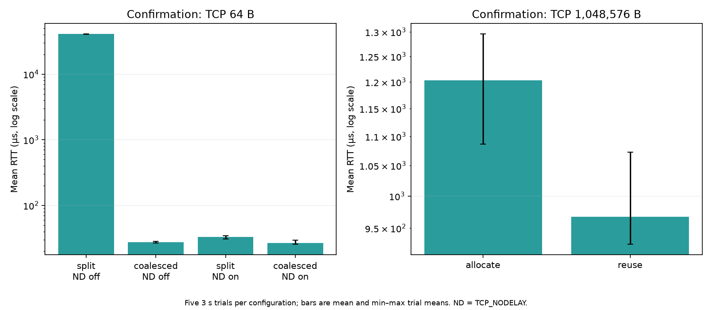
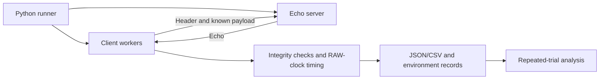

# Linux TCP/UDP Benchmark

A C++20 request/echo benchmark for Linux. It measures application round-trip time, payload goodput, UDP missing echoes, and process CPU usage while varying message size, socket buffers, concurrency, and I/O mode.

The main investigation is how application choices affect socket performance. In five 3-second loopback trials per configuration, reusing buffers reduced 1 MiB TCP mean RTT from **1,203 to 967 µs**, with **7.2% less client CPU time per completed message**. Coalescing small TCP writes removed an observed Nagle/delayed-ACK stall. Nonblocking I/O did not show a consistent goodput improvement in the tested workload.

These are measurements of a paced echo workload on one machine. They are not link-capacity results. Full controls, sample counts, regressions, and limitations are in the [analysis](docs/ANALYSIS.md).



## Implementation

- Direct Linux/POSIX sockets, with blocking and nonblocking `poll()` paths.
- Explicit 24-byte TCP framing; partial transfers, EINTR, EOF, backpressure, and deadlines are handled.
- UDP message/fragment sequence tracking, duplicate detection, byte validation, and missing-echo accounting.
- Payloads from 64 B to 1 MiB, up to 32 client workers, finite durations/message counts, and aggregate request budgets.
- Independent switches for split/coalesced writes and allocated/reused buffers.
- JSON/CSV output and Python tooling for randomized repeated trials, environment capture, and plots.

## Build and test

Requires Linux, CMake 3.20+, a C++20 compiler/library supporting `std::barrier`, and pthreads. Tests use GoogleTest and Python 3.10+. Plotting and analysis tests use matplotlib.

```bash
# Debian/Ubuntu dependencies, if needed:
sudo apt-get install build-essential cmake libgtest-dev python3-venv

cmake -S . -B build -DCMAKE_BUILD_TYPE=Release
cmake --build build -j 4
ctest --test-dir build --output-on-failure
```

For a runtime-only build, add `-DBUILD_TESTING=OFF`. For AddressSanitizer and UndefinedBehaviorSanitizer, use a separate build:

```bash
cmake -S . -B build-asan -DCMAKE_BUILD_TYPE=Debug -DNETBENCH_SANITIZERS=ON
cmake --build build-asan -j 4
ASAN_OPTIONS=detect_leaks=1:halt_on_error=1 UBSAN_OPTIONS=halt_on_error=1 \
  ctest --test-dir build-asan --output-on-failure
```

Use release builds for timing comparisons. See [validation](docs/VALIDATION.md) for coverage and development checks.

## Run locally

Both programs default to `127.0.0.1:9000`. Start the server in one terminal:

```bash
./build/netbench_server --protocol tcp --clients 4 --duration 30 --buffering reuse
```

Run the client in another:

```bash
./build/netbench_client --protocol tcp --payload 1024 --clients 4 \
  --duration 2 --messages 10000 --write coalesced --buffering reuse --nodelay 1
```

For the allocation/split-write reference, use `--buffering allocate` on both processes and `--write split` on the client. Hold other settings constant for comparisons. Socket settings are controlled with `--sndbuf`, `--rcvbuf`, and `--nodelay`; `--io blocking|nonblocking` selects data-socket behavior.

For UDP, restart the server with `--protocol udp` and choose UDP on the client:

```bash
./build/netbench_client --protocol udp --payload 1048576 --duration 2 \
  --messages 100 --timeout-ms 1000 --buffering reuse
```

`--format csv` selects CSV; JSON is the default. `--iterations 5` repeats the measurement with new client sockets. `--help` lists options. The first duration/message limit stops new messages; started messages can finish or time out afterward. Errors, timeouts, and empty runs exit nonzero. Empty latency samples are reported as null.

Defaults are one client, one second, 1,000 messages/client, and aggregate request budgets of 10,000 messages/s and 100 Mbps. The initial message can start immediately, so finite windows can exceed the nominal scheduling budget by one message/client. Echoes and protocol headers create additional traffic. The server exits at its duration limit or on SIGINT/SIGTERM.

## Measurement model



Each worker has one logical request outstanding. TCP messages use a length/sequence header; reads are never assumed to preserve message boundaries. UDP payloads above 1,200 B use application fragments, each echoed before the next is sent. Large UDP logical RTT therefore includes intentional fragment pacing.

RTT includes current-message preparation, socket operations, scheduling, and echo validation; connection setup is excluded. Goodput counts complete validated request payload once, excluding echoes and headers. UDP loss means missing round-trip echoes before a deadline, which cannot identify the direction or cause of loss. No one-way latency or application-derived TCP packet-loss metric is reported.

The [measurement contract](docs/METHODOLOGY.md) defines CPU accounting, quantiles, pacing, and timing-window effects. The [architecture](docs/ARCHITECTURE.md) describes framing, ownership, and shutdown.

## Reproduce experiments

The runner uses the Python standard library. Install plotting/development tools in an environment:

```bash
python3 -m venv .venv
.venv/bin/pip install -r requirements-dev.txt

python3 scripts/run_experiments.py --profile comparison \
  --repeats 5 --duration 1 --output results/local-comparison
python3 scripts/run_experiments.py --profile survey \
  --repeats 5 --duration 1 --output results/local-survey
.venv/bin/python scripts/analyze.py results/local-comparison results/local-survey \
  --output results/local-plots
```

Use a new output directory for each campaign. The runner preserves commands, return codes, failed runs, environment/build metadata, binary hashes, and source snapshots. The analyzer rejects comparisons with mismatched workload controls and retains failed-trial counts. `--profile confirmation --repeats 5 --duration 3` reproduces the longer campaign structure. For a syscall diagnostic, install `strace` and run `python3 scripts/trace_writes.py --output results/local-traces` separately from timing trials.

The survey has 28 configurations; `--repeats 40` schedules 1,120 trials. The checked-in campaign contains **301 measured trials**, not 1,000+. Its raw records and selected plots are retained under [results](results/README.md); local campaigns, duplicate exports, and tooling output are ignored by Git.

## Recorded results

Measurements were collected on an AMD Ryzen 5 3600, Linux `7.1.4-arch1-1`, GCC 16.1.1, release build, loopback, with no CPU pinning. Each dataset contains its own metadata and historical source version.

| Comparison | Mean RTT before → after | Interpretation |
|---|---:|---|
| 64 B TCP, NODELAY off, split → coalesced | 40,801 → 27.31 µs | Removed the observed small-write stall |
| 64 B TCP, NODELAY on, split → coalesced | 33.05 → 26.90 µs | Smaller latency gain; similar paced goodput |
| 1 MiB TCP, coalesced/NODELAY on, allocate → reuse | 1,203 → 967 µs | 19.6% lower RTT; 7.2% lower CPU/message |
| 16 KiB TCP, send/receive buffers 4 → 64 KiB | 176.77 → 52.74 µs | Lower RTT; goodput remained about 95.8 Mbps |

The first three rows use five 3-second trials per configuration; the buffer row uses three 0.6-second trials. Large-message trials still have few samples for reliable p99 estimates. Shorter runs showed a larger reuse gain, which is also reported rather than selected as the headline. Initial timing-biased results are preserved and excluded from primary comparison plots. See [analysis and trade-offs](docs/ANALYSIS.md) for the full interpretation.

More plots: [latency/payload](results/plots/latency_payload.png), [goodput/payload](results/plots/throughput_payload.png), [concurrency](results/plots/throughput_clients.png), [CPU/goodput](results/plots/cpu_throughput.png), [buffer CPU cost](results/plots/buffer_cpu.png), [socket buffers](results/plots/socket_buffers.png), and [trial variation](results/plots/trial_variation.png). The analyzer also generates SVG exports locally.

## Code and documentation

`src/client.cpp` and `src/server.cpp` contain the executables. `common`, `protocol`, and `metrics` provide shared socket/timing, wire-format, and reporting code. `tests/` contains unit, integration, and automation regressions; `scripts/` contains experiment and plotting tools.

[Design decisions](docs/DECISIONS.md) explain the choices and future work. An epoll reactor, pipelined bulk mode, batching APIs, real-NIC tests, and embedded-target measurements are outside this version. A [beginner walkthrough](docs/LEARNING_GUIDE.md) explains the underlying C++, networking, and measurement concepts from scratch.
