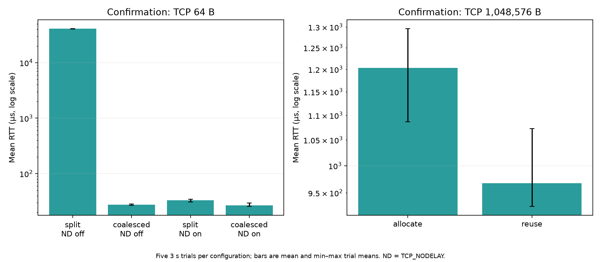

# Observed bottlenecks, optimizations, and limits

## Evidence and provenance

This analysis uses **301 actual measured trials** on the local machine, plus four separately recorded warmup runs and a separate syscall diagnostic. No earlier-project numbers are reconstructed or invented.

| Dataset | Configurations × repetitions | Duration setting | Purpose |
|---|---:|---:|---|
| `results/baseline/` | 19 × 3 = 57 | 0.5 s | Initial implementation; find bottlenecks and timing artifacts |
| `results/comparison/` | 24 × 5 = 120 | 0.6 s | Factorial write/buffering/NODELAY comparison at three payloads |
| `results/survey/` | 28 × 3 = 84 | 0.6 s | Payload, transport, buffers, concurrency, blocking/nonblocking |
| `results/confirmation/` | 8 × 5 = 40 | 3 s | Longer confirmation of small writes, buffer reuse, UDP behavior |

All 301 runs returned success with zero reported server errors. All local UDP measured trials observed zero missing echoes. Intentional drop/stall/error fixtures are correctness tests, excluded from these performance datasets.

Hardware/environment: AMD Ryzen 5 3600 6-Core Processor (12 logical CPUs available), x86_64 Linux `7.1.4-arch1-1`, GCC 16.1.1, CMake Release, schedutil governor, unpinned process affinity on all available CPUs. Each dataset records the exact environment, sysctls, load averages, commands, binary hashes, raw stdout/stderr, and source archive. These are local observations, not results from a NIC, embedded target, or remote host. Build/test hardening after the experiments adds deadline-bounded fragment pacing for extreme low-rate settings thread-start/shutdown exception cleanup, reconnect-safe worker admission, and partial-frame EOF classification; the measured source archives remain the authoritative code for each historical run. Later review also separates the client transport functions, sizes reusable UDP buffers to a fragment, rejects empty runs, and hardens the experiment/analysis tooling. Those changes are not retroactively assigned the recorded performance numbers.

Means below are arithmetic means of per-trial summaries. Ranges are min–max across trials, not confidence intervals. No trial is selected because it was fastest. Machine state, trial length, first-message effects, and the workload definition limit generalization.

## 1. Small TCP writes were the dominant avoidable latency problem

The baseline wrote a 24-byte header, then its body in a separate call. At 64 B–16 KiB with NODELAY off, RTT averaged about 38 ms in short initial runs. Switching NODELAY on at 1 KiB reduced the baseline mean to about 31 µs. That justified testing a complete-frame write with the same underlying protocol.

Longer controlled confirmation (64 B payload, allocate buffers, one blocking client):

| Write strategy | NODELAY | Mean RTT, µs [trial range] | Goodput, Mbps | Client CPU % | RTT samples/trial |
|---|---:|---:|---:|---:|---:|
| Split | 0 | 40,801 [40,690–40,961] | 0.01255 | 0.069 | 74 |
| Coalesced | 0 | 27.31 [26.65–28.17] | 3.282 | 8.13 | 19,156–19,284 |
| Split | 1 | 33.05 [30.96–34.27] | 3.280 | 10.10 | 19,119–19,333 |
| Coalesced | 1 | 26.90 [25.49–29.73] | 3.275 | 7.99 | 18,669–19,371 |

The 40 ms stall and its disappearance with NODELAY or coalescing are consistent with Nagle/delayed-ACK interaction. This is an inference from controlled behavior, not packet-capture proof of a specific kernel timer. Linux documents Nagle suppression through TCP_NODELAY in [tcp(7)](https://man7.org/linux/man-pages/man7/tcp.7.html).

A separate `strace -f -tt -T` diagnostic confirms 16 send syscalls for eight split-write requests and eight for eight coalesced requests. In the split case, later receive calls waited approximately 40–41 ms. These trace timings are diagnostic only: ptrace changes timing, so they are not merged with performance runs. Raw traces are under `results/diagnostics/`.

With NODELAY already on, coalescing reduced mean RTT by about **18.6%** in the longer runs. Goodput did not improve: the request-rate budget and sleep behavior govern it. Client CPU fell from 10.10% to 7.99% at nearly the same completed-message rate. With NODELAY off, total CPU increased after fixing the stall because the client completed vastly more work; a lower RTT does not imply lower total CPU for a fixed-duration trial.

Coalescing alone was **not a consistent large-payload win**. At 1 MiB, NODELAY off, allocate mode in the 0.6 s factorial runs, split averaged 1,666 µs and coalesced 1,752 µs, with overlapping trial ranges. Those runs are retained. The small-write improvement must not be generalized to all payload sizes.

## 2. Reusable buffers reduced large-message work, with a duration-dependent gain

The allocation baseline creates transmit/receive vectors per request, initializes their storage, and copies the known payload into a transmit frame. The TCP server allocates its echo frame per request. Reuse mode retains buffers, prepares invariant bytes once, updates the header, and reuses server frame capacity.

This changes allocation, zero-initialization, and data copying together. It measures a buffering strategy, not a pure allocator cost or zero-copy transport. The kernel still copies socket data, and the client still compares every returned payload byte.

One blocking TCP client, 1 MiB, coalesced writes, NODELAY on, same pacing and buffers:

| Trial duration | Buffer strategy | Mean RTT, µs [trial range] | Client CPU µs/completed message | Goodput, Mbps | Samples/trial |
|---|---|---:|---:|---:|---:|
| 0.6 s | Allocate | 1,647 [1,600–1,701] | 1,301 | 111.81 | 8 |
| 0.6 s | Reuse | 976 [898–1,076] | 1,128 | 111.76 | 8 |
| 3 s | Allocate | 1,203 [1,086–1,296] | 977 | 100.657 | 36 |
| 3 s | Reuse | 967 [926–1,073] | 906 | 100.650 | 36 |

Each row is five trials. Reuse improved mean RTT by **40.7% in the short runs and 19.6% in the longer runs**; CPU/message fell **13.3% and 7.2%**, respectively. Reporting only the larger short-run gain would overstate what the longer experiment supports. First-message costs, memory/page/cache state, allocator behavior, scheduling and sample count can affect this difference; no allocation profiler was run to isolate their contributions.

CPU/message includes initial worker payload/buffer setup, pacing syscalls, and final worker work divided by completed messages. Setup outside the per-message RTT is still inside process CPU and elapsed time; CPU/message can therefore exceed the mean RTT of a worker. Reuse retains memory until connection teardown, trading bounded per-connection memory for less repeated work.

Throughput remains essentially unchanged because starts are paced. Values above the 100 Mbps setting are a documented finite-message boundary effect, addressed below, not a link-speed result.

## 3. Socket-buffer tuning affected latency more than capped goodput

Survey: 16 KiB payload, one blocking TCP client, NODELAY off, coalesced writes, reusable buffers, equal requested send/receive sizes on both endpoints, three trials each:

| Requested size | Mean RTT, µs | Goodput, Mbps | Client CPU % |
|---|---:|---:|---:|
| 4 KiB | 176.77 | 95.73 | 6.04 |
| 64 KiB | 52.74 | 95.81 | 1.84 |
| 256 KiB | 54.41 | 95.81 | 1.91 |

Small buffers increase backpressure/partial-transfer work; that is consistent with the latency/CPU change, but syscall profiling of these particular buffer runs was not performed. Once the buffers were sufficient for this workload, increasing them further did not produce a measurable useful goodput gain. The UDP 16 KiB fragment workload stayed near 1,296 µs with all three sizes, with no observed loss, consistent with its fragment pacing dominating logical RTT.

Requested sizes are not actual kernel allocations. [socket(7)](https://www.man7.org/linux/man-pages/man7/socket.7.html) documents Linux buffer bookkeeping behavior; effective values are retained per connection and for the server listener/socket. For example, requesting 4,096 bytes produced an effective 8,192-byte observation here. TCP autotuning can subsequently change buffers.

## 4. Concurrency helped achieved request rate; nonblocking waits did not improve it consistently

Survey: 1 KiB payload, reuse/coalesced, default buffers, NODELAY off. All rows share the same aggregate request budgets: 10,000 logical messages/s and 100 Mbps. At this payload the request-rate cap implies at most 81.92 nominal request Mbps before sleep overhead.

| Transport | Clients | Blocking Mbps / CPU % | Nonblocking Mbps / CPU % |
|---|---:|---:|---:|
| TCP | 1 | 52.69 / 8.41 | 52.59 / 9.27 |
| TCP | 4 | 71.69 / 12.54 | 71.76 / 13.47 |
| TCP | 8 | 76.46 / 13.57 | 76.37 / 15.15 |
| UDP | 1 | 52.44 / 7.62 | 52.74 / 8.60 |
| UDP | 4 | 71.58 / 12.12 | 71.77 / 12.57 |
| UDP | 8 | 76.47 / 12.28 | 76.42 / 13.97 |

More clients distribute the same budget across workers with longer individual pacing intervals, reducing the relative effect of sleep/scheduling overhead. This is consistent with the scaling observed, but no scheduler trace was collected to attribute all of it. It is not proof of core-linear scaling or increased network capacity. CPU usage rises as the client processes more requests.

Nonblocking sockets use O_NONBLOCK and `poll()` on EAGAIN. They retain the worker-per-connection architecture; there is no epoll reactor. Throughput differences were small and mixed, while nonblocking client CPU was higher in every surveyed pair. The retained result is **no demonstrated nonblocking throughput improvement for this workload**. A reactor under much larger concurrency would be a separate experiment.

## 5. TCP vs. UDP depends on the logical workload

At 64 B in the optimized survey, TCP mean RTT was 26.38 µs and UDP 23.30 µs. At 1 KiB, TCP was 27.45 µs and UDP 23.33 µs. These local low-payload observations support a modest UDP RTT advantage under this echo implementation; they do not establish a general transport ranking.

Above 1,200 B, UDP uses multiple application datagrams with per-fragment stop-and-wait pacing. At 1 MiB it uses 874 fragments and has a logical RTT of approximately 83.9 ms, near the intended 100 Mbps message interval. TCP transfers the same logical bytes as one stream frame and then waits between requests. That is a different traffic shape; the large UDP RTT is dominated by benchmark policy. Native UDP does not support a 1 MiB datagram, and this project does not hide that fact behind invalid socket calls.

Zero observed missing echoes on loopback at these bounded rates says little about congestion, reorder depth, burst loss, remote clock behavior, or receiver overload. The loss fixture proves accounting when echoes are absent; it is not a measured network impairment study. Echo loss combines both directions and deadline misses. TCP application reads do not expose TCP packet loss.

## 6. Timing artifacts, repeated trials, and tails

The original duration loop could end as soon as the next scheduled request lay beyond the duration boundary, without waiting out the final gap. Six 1 MiB TCP requests could finish near 0.422 s in a 0.5 s test, producing about 119 Mbps. The original records and source remain in `results/baseline/`. Primary comparison plots use split/allocate controls from the corrected factorial harness, not these initial timing-biased runs.

The corrected loop waits to the configured end when the next scheduled start falls outside the window. An immediate initial message still permits one-message/client boundary overshoot: eight 1 MiB messages in approximately 0.6 s yield 111.8 Mbps, and 36 in approximately 3 s yield 100.66 Mbps. Counts, intervals, and elapsed time explain these numbers without a capacity claim. Longer runs reduce the relative boundary effect. Rate limits are scheduled request-payload budgets, not exact wire-rate shaping.

Longer small-message coalesced confirmation trials contain roughly 19,000 successful RTTs each, but 1 MiB trials contain only 36 and the stalled split-write case only 74. A nearest-rank p99 with 36 samples is the maximum. These fields are recorded for completeness; they are not reliable estimates of an underlying 99th percentile. Successful RTT quantiles also exclude timed-out messages and must be read with loss/completion counts.

Trial variation matters: 64 B coalesced/NODELAY-on confirmation mean RTT ranged from 25.49 to 29.73 µs, while its p99 ranged from 57.52 to 97.30 µs. One apparently excellent run would conceal that variation. Plot error bars show observed min–max ranges, not statistical significance or population confidence bounds.

## Reproduce or extend

Run `scripts/run_experiments.py` with the saved profile, duration, repeat count, seed, rate, and Mbps from `plan.json`; use the source archive to rebuild an exact historical implementation. Run analysis against all datasets to regenerate PNG/SVG figures and aggregate JSON/CSV. Numerical values on another machine will differ.

Next investigations would isolate pipeline depth, reactor architecture, UDP batching, real network/embedded hardware, receiver-side UDP counters, CPU affinity/frequency and kernel retransmission telemetry. None is claimed as implemented or measured. The useful conclusions here are specific: fix framing first; small-write policy can dominate RTT; buffer reuse can reduce large-message application work; and pacing, sample count, and timing-window choices constrain every performance claim.
