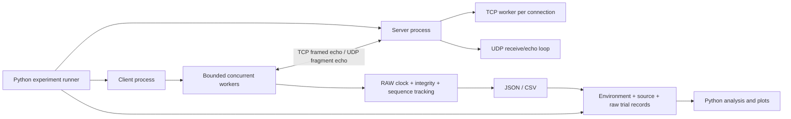

# Architecture and wire protocol

`common` owns file descriptors, numeric configuration validation, socket options, monotonic timing, pacing, polling, and complete stream transfers. `protocol` encodes bytes explicitly, avoiding packed-struct ABI/alignment/endianness assumptions. `metrics` pools successful samples and serializes results. Client and server stay small and protocol-specific.

## Version 1 header

All integers use network byte order. There is no reliance on struct padding.

| Offset | Width | Meaning |
|---|---:|---|
| 0 | 4 | Magic/version `0x4e423031` (`NB01`) |
| 4 | 4 | Total logical payload bytes, 64..1,048,576 |
| 8 | 8 | Sequence number, starting at zero for each client/iteration |
| 16 | 4 | Fragment index (TCP: zero) |
| 20 | 4 | Fragment count (TCP: one; UDP: ceil(payload/1,200)) |

TCP reads exactly 24 header bytes and validates length before allocating a bounded body. It then reads exactly the body length, sends the complete echo, and repeats. Neither a `send()` nor a `recv()` is assumed to correspond to a message. Both transfer loops advance by the actual byte count, retry EINTR, detect EOF/zero send, wait for readiness after EAGAIN, and retain an absolute deadline across partial progress. A TCP timeout ends that connection because its framing position may be ambiguous.

UDP uses `sendto()` and `recvfrom(MSG_TRUNC)`; oversized datagrams are rejected rather than silently truncated. A fragment's expected length is derived from its logical length and index and checked before echoing. The server needs no unbounded reassembly map: it echoes individual fragments; the client validates and tracks their uniqueness for its current logical message. Connected client UDP sockets filter source address/port. Sequence numbers distinguish stale echoes between logical messages. Duplicate and out-of-order fragment accounting is explicit; the default stop-and-wait workload rarely produces reordering naturally.

TCP servers use `socket`, `setsockopt`, `bind`, `listen`, nonblocking `accept4`, and one worker per accepted connection, limited by `--clients`. Finished workers are joined and removed. A listener `poll()` keeps the accept loop responsive. UDP uses a single echo loop and readiness polling in both modes; it does not pretend that selecting nonblocking I/O creates an epoll server. `--io nonblocking` sets O_NONBLOCK on data sockets and uses `poll()` on EAGAIN; blocking sockets use bounded kernel waits. This compares waiting behavior within the same thread architecture. A future single-thread epoll reactor would be a separate architecture experiment.

Connect is temporarily nonblocking in both modes: `poll(POLLOUT)` followed by `getsockopt(SO_ERROR)` enforces a bounded connect deadline, then restores the chosen data-I/O mode. `MSG_NOSIGNAL` prevents peer disconnects from terminating the process with SIGPIPE. `SOCK_CLOEXEC` prevents accidental descriptor inheritance. Move-only RAII descriptors close on all ordinary exception paths. Lock-free atomic shutdown state is set by SIGINT/SIGTERM handlers; workers check it during waits and pacing. Excess TCP connections wait in a finite listen backlog until worker capacity becomes available, avoiding reconnect/reaping races. The server reports accepted connections, peak workers, and errors; the client exits nonzero on errors/timeouts or empty measurements and emits null latency when there are no successful samples.

The server is an intentionally unauthenticated echo endpoint. Its default loopback bind and finite duration suit local experiments. Binding a non-loopback address is an explicit operator choice; it is not a production network service.

## Linux API references

- [socket(7)](https://www.man7.org/linux/man-pages/man7/socket.7.html): options and Linux socket semantics.
- [tcp(7)](https://man7.org/linux/man-pages/man7/tcp.7.html): byte streams, TCP_NODELAY and TCP buffers.
- [udp(7)](https://www.man7.org/linux/man-pages/man7/udp.7.html): datagram semantics and path MTU behavior.
- [clock_gettime(3)](https://www.man7.org/linux/man-pages/man3/clock_gettime.3.html): CLOCK_MONOTONIC_RAW timing.
